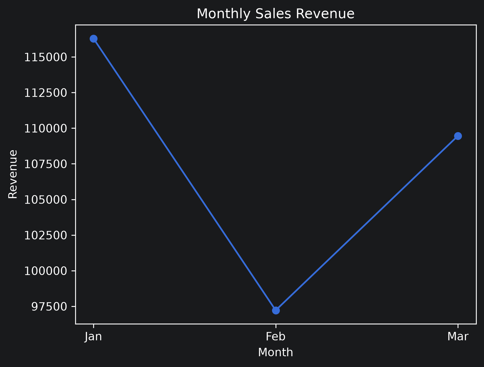
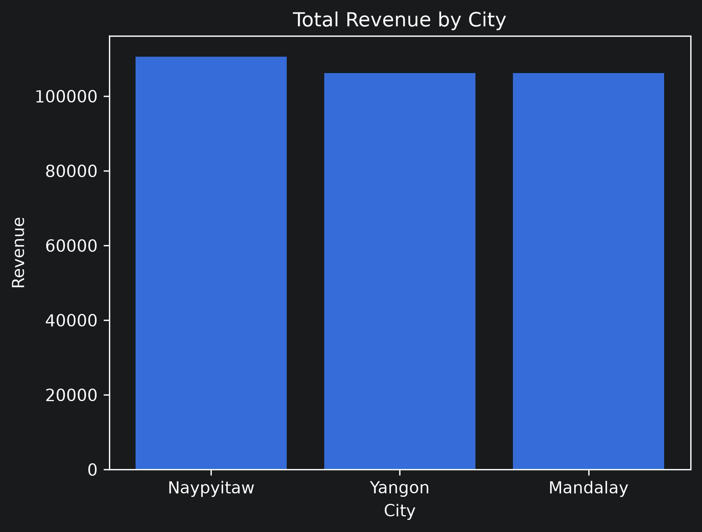

# Retail Store Sales Analysis

## Project Overview

This project analyzes 1,000 supermarket transactions to understand sales performance, customer purchasing behavior, and product category trends.

The objective is to identify useful business insights through data cleaning, exploratory data analysis, SQL queries, and data visualization.

## Tools and Technologies

- **Python** — Data analysis
- **Pandas** — Data cleaning and aggregation
- **Matplotlib** — Data visualization
- **PostgreSQL** — SQL analysis
- **DBeaver** — Database management
- **Jupyter Notebook** — Interactive analysis

## Dataset

The dataset contains 1,000 supermarket transactions across three cities in Myanmar: Yangon, Mandalay, and Naypyitaw.

It includes 17 columns covering transaction details, products, prices, payment methods, customer types, and ratings.

## Key Performance Indicators

| KPI | Result |
|---|---:|
| Total Revenue (including tax) | 322,966.75 |
| Total Transactions | 1,000 |
| Average Transaction Value | 322.97 |
| Highest Transaction Value | 1,042.65 |

## Key Business Insights

1. **Branch Performance:** Branch C generated the highest revenue at 110,568.71.
2. **Product Performance:** Food and beverages generated the highest revenue, while Electronic accessories sold the most units.
3. **Monthly Revenue:** January recorded the highest revenue, followed by March and February.
4. **Customer Analysis:** Member transactions generated slightly higher revenue and average transaction values than normal customer transactions.
5. **Payment Methods:** Ewallet was the most frequently used payment method, but cash generated the highest revenue.
6. **City Performance:** Naypyitaw generated the highest revenue despite having the fewest transactions.

## Data Cleaning

- Inspected dataset structure and data types.
- Checked for missing values and duplicate records.
- Confirmed zero missing values and zero exact duplicate rows.
- Converted the Date column to a datetime data type.

## Visualizations

### Revenue by Product Category


### Monthly Revenue Trend



### Revenue by City



## SQL Analysis

The project includes six SQL analyses covering:

- Overall sales performance
- Branch performance
- City performance
- Product category performance
- Customer type analysis
- Payment method analysis

SQL queries are available in [`sql/analysis.sql`](sql/analysis.sql).

## Project Structure

```text
retail-store-analysis/
├── data/
│   └── supermarket_sales.csv
├── reports/
│   └── figures/
│       ├── revenue_by_category.png
│       ├── monthly_revenue.png
│       └── city_revenue.png
├── sql/
│   └── analysis.sql
├── 01_data_exploration.ipynb
└── README.md
```

## Conclusion

This project demonstrates how Python, Pandas, Matplotlib, and PostgreSQL can be used to analyze retail sales data and produce actionable business insights.

The analysis highlights differences in revenue, transaction volume, product performance, and customer purchasing patterns.